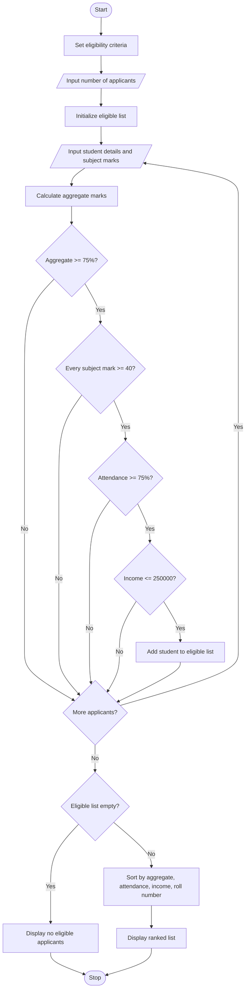

# Problem Statement
Design and develop a Python program for a University Scholarship Allocation System that evaluates students based on aggregate marks, subject-wise minimum marks, attendance percentage, and annual family income.

The system must identify eligible students by checking all the required criteria, rank eligible applicants according to their aggregate marks, and resolve ties using predefined rules such as higher attendance, lower family income, and roll number in ascending order. Finally, display the ranked list of eligible students.
 # Algorithm
1. Start the program.
2. Set the eligibility criteria:
   - Minimum aggregate marks = 75%.
   - Minimum marks in each subject = 40.
   - Minimum attendance = 75%.
   - Maximum annual family income = ₹2,50,000.
3. Read the number of applicants.
4. For each applicant:
   - Read the student's name and roll number.
   - Read the number of subjects and marks obtained in each subject.
   - Calculate aggregate marks.
   - Read attendance percentage and annual family income.
5. Check whether the applicant satisfies all four eligibility criteria.
6. If all criteria are satisfied, add the student to the eligible applicants list.
7. Sort eligible applicants using these rules:
   - Higher aggregate marks first.
   - Higher attendance first when aggregate marks are equal.
   - Lower family income first when attendance is also equal.
   - Roll number in ascending order if all previous criteria are equal.
8. Display the ranked list of eligible students.
9. If no students are eligible, display an appropriate message.
10. Stop the program.

#Flowchart

#sample input

Enter number of applicants: 2

Enter details of Applicant 1
Enter student name: kavya
Enter roll number: 102
Enter number of subjects: 3
Enter marks in subject 1: 85
Enter marks in subject 2: 80
Enter marks in subject 3: 90
Enter attendance percentage: 90
Enter annual family income: 200000

Enter details of Applicant 2
Enter student name: Priya
Enter roll number: 101
Enter number of subjects: 3
Enter marks in subject 1: 90
Enter marks in subject 2: 85
Enter marks in subject 3: 80
Enter attendance percentage: 95
Enter annual family income: 180000

#sample output

========== SCHOLARSHIP RESULTS ==========

Eligible Students - Ranked List
---------------------------------------------------------------------------
Rank  Name              Roll No     Aggregate   Attendance   Income
---------------------------------------------------------------------------
1     Priya             101         85.00       95.00        180000.00
2     Ravi              102         85.00       90.00        200000.00

Scholarship allocation process completed.

# conclusion

The University Scholarship Allocation System automates the process of checking scholarship eligibility and ranking applicants. It considers academic performance, subject-wise minimum marks, attendance, and family income. The predefined tie-breaking rules ensure consistent ranking when students have equal aggregate marks.

